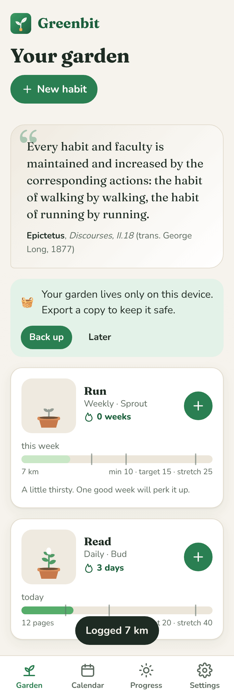
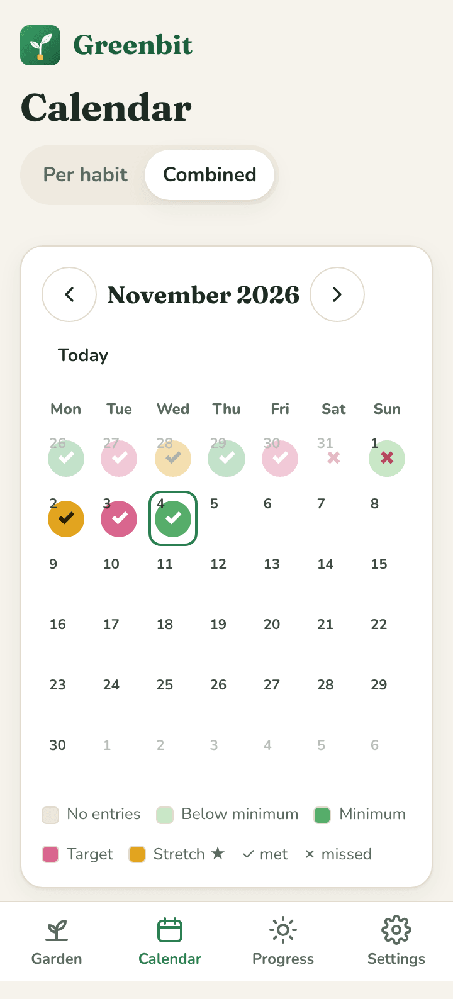
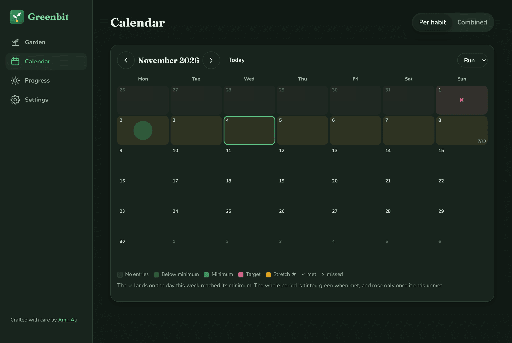

<p align="center">
  <picture>
    <source media="(prefers-color-scheme: dark)" srcset="brand/logo-wordmark-dark.svg">
    
  </picture>
</p>

<p align="center">
  <strong>Grow habits like a garden.</strong><br>
  A local-first, offline-ready habit tracker where every habit is a plant that grows with small, steady effort.
</p>

<p align="center">
  <a href="https://greenbit-six.vercel.app"><strong>🌱 Open the live app</strong></a> ·
  <a href="https://amir-ali.me">Built by Amir Ali</a> ·
  <a href="#features">Features</a> ·
  <a href="#getting-started">Getting started</a> ·
  <a href="#how-it-works">How it works</a>
</p>

---

<p align="center">
  
  &nbsp;
  
</p>

## What is Greenbit?

Greenbit is a Progressive Web App for building habits without accounts, servers or tracking. Everything you log stays in your browser's IndexedDB on your device. You install it like an app on iOS, Android or desktop, and it keeps working with no connection.

Each habit gets three goals per period:

| Threshold | Meaning |
| --- | --- |
| **Minimum** | The least that still counts. Reaching it marks the period ✓ done. |
| **Target** | What a normal good day, week or month looks like. |
| **Stretch** | Going beyond expectations. Your plant blooms gold. |

Habits can be **daily**, **weekly** or **monthly**. Log as many entries as you like (e.g. 10 pages this morning, 15 tonight); they are summed per period. Ticks, streaks, colours, sunlight (XP), levels, plant stages and badges are **all derived from your entries** at read time. Nothing derived is stored, so editing or backfilling an entry instantly and consistently updates everything.

## Features

- 🌱 **Garden home**: one plant per habit that grows from seed → sprout → bud → bloom, with a current streak and a progress bar showing minimum / target / stretch for the current period.
- ➕ **Quick-add stepper** with +1 / +5 / +10 presets, custom amounts, notes and backfill to any past date.
- 📅 **Calendar** with two modes (your choice is remembered):
  - *Per habit*: daily cells coloured by tier. Weekly/monthly habits place the ✓ on the day the running total crossed the minimum, and tint the whole period.
  - *Combined*: every habit in one view, with ✓ / `2/3` / ✗ per day and a colour for the average tier.
- 🗓️ **Gentle rules**: an open period is never marked ✗ and never breaks your streak. Missed periods let plants wilt a little; they recover with the next good period.
- ☀️ **Gamification**: sunlight per period (below 1 · minimum 10 · target 15 · stretch 25), levels on a `50 · n^1.5` curve, garden stages from *Patch of soil* to *Grove*, eight badges and petal celebrations when you cross a threshold.
- 📜 **Daily quote** from public-domain translations of classic works (Marcus Aurelius, Seneca, Epictetus, Aristotle, William James and others), always with a named source.
- 💾 **Export / import** as a single JSON file, validated with `zod`, with *merge* or *replace* applied atomically in one transaction. A nudge appears if you haven't backed up in 14 days.
- 📲 **PWA**: installable, works fully offline, self-hosted fonts, no network requests after load, auto-updating service worker.
- 🌓 **Dark mode**, keyboard accessible, `prefers-reduced-motion` respected, usable from 360px wide.

<p align="center">
  
</p>

## Getting started

Requires Node 20+.

```bash
npm install
npm run dev        # http://localhost:5173
```

| Script | What it does |
| --- | --- |
| `npm run dev` | Start the Vite dev server |
| `npm run build` | Validate quotes, type-check and build the PWA into `dist/` |
| `npm run preview` | Serve the production build locally |
| `npm test` | Run the Vitest suite |
| `npm run validate:quotes` | Fail if any quote lacks an author/source or is duplicated |

## How it works

### Stack

React 18 · TypeScript · Vite · `vite-plugin-pwa` (Workbox) · Dexie (IndexedDB) · Zustand · date-fns · Framer Motion · zod · Vitest + Testing Library.

### Project layout

```
src/
  core/         Pure, framework-free logic with unit tests
                (periods, volume tiers, status, streaks, calendar, xp, plant, badges, backup)
  data/         quotes.json, plant species
  db/           Dexie schema, repository (CRUD, import, reset), live-query hooks
  store/        Zustand UI state (today, calendar cursor, celebrations, toasts)
  components/   Plant, QuoteCard, Sheet, EntrySheet, MonthGrid, ThresholdBar…
  pages/        Garden, Calendar, HabitDetail, HabitForm, Progress, Settings
  styles/       Design tokens (light + dark) and global styles
scripts/        validate-quotes.ts
brand/          Logo sources and icon generator
```

### Data model

Only **habits**, **entries** and **settings** are stored. Dates are local `YYYY-MM-DD` strings, never UTC timestamps, so time zones and DST can't shift a day.

```ts
interface Habit { id; name; unit; frequency: 'daily' | 'weekly' | 'monthly';
                  minimum; target; stretch; plant; createdAt; archivedAt? }
interface Entry { id; habitId; date; volume; note? }
```

### Decisions worth knowing

- **Backfilling before a habit's start date** moves the habit's `createdAt` back to that date, so the backfilled period counts.
- **Changing thresholds or frequency** recalculates all history (the form warns you first). That follows from never storing derived values.
- **Combined calendar**: weekly/monthly habits only count on their completion day (✓) or on the last day of a missed period (✗). They never count against the other days.
- **Merge import** adds anything missing by id; if a record exists on both sides, the one edited most recently wins.
- **Backups from newer app versions** are rejected with a clear message. A `migrate()` hook upgrades older formats.
- Every tier colour is paired with a non-colour cue (✓, ✗, ★ for stretch, and text labels) so the calendar stays readable with colour-vision deficiencies.

### Quotes

`src/data/quotes.json` holds 68 quotes, each with an author, a work, a book/letter/chapter reference and, where relevant, the public-domain translator. The selector is `quotes[dayOfYear % quotes.length]`, so the quote changes at local midnight and the list can grow to 365 with no code change.

> **Human review needed before release.** The quotes were transcribed from well-known public-domain translations without being machine-checked against the source texts. Each one has a precise reference to make that check quick.

## Deployment

Live at **[greenbit-six.vercel.app](https://greenbit-six.vercel.app)**. The app is a static site, deployed on Vercel from this repository on every push (`vercel.json` holds the SPA rewrite and cache headers for the service worker). Any static host works: build and serve `dist/`.

## Author

Designed and built by **Amir Ali**: [amir-ali.me](https://amir-ali.me) · [GitHub](https://github.com/amirsaeed671)

If Greenbit helps you grow something, a ⭐ on the repo is appreciated.
