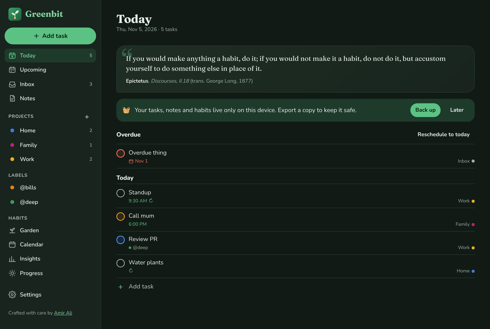
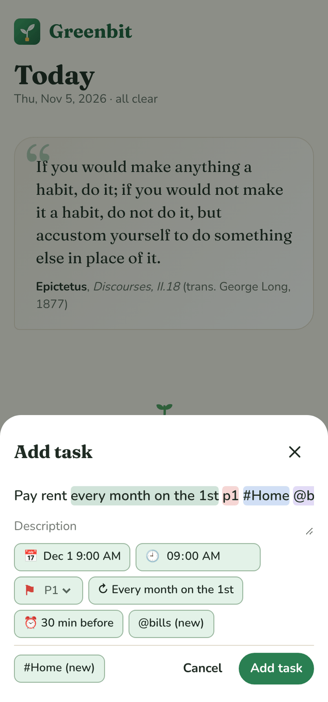
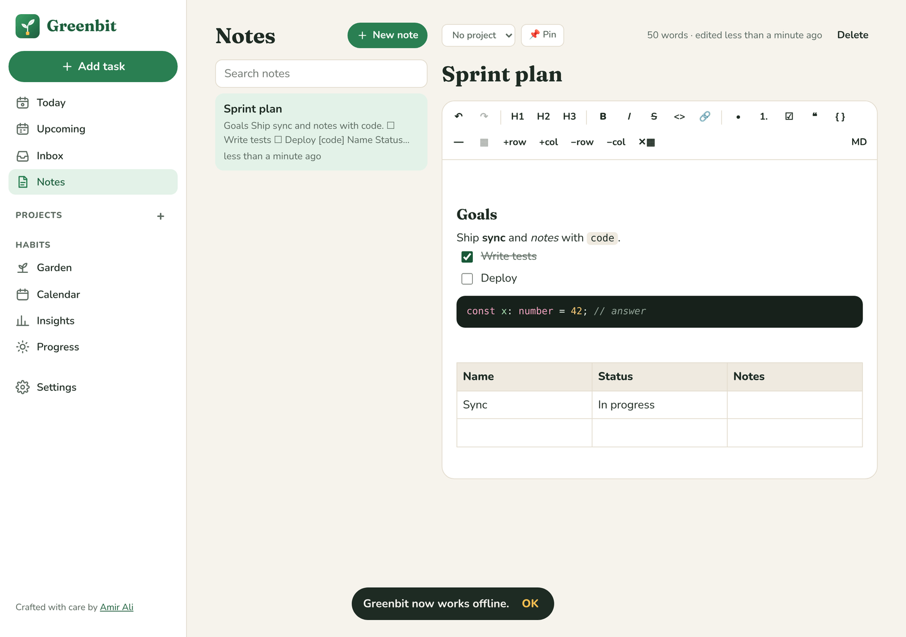
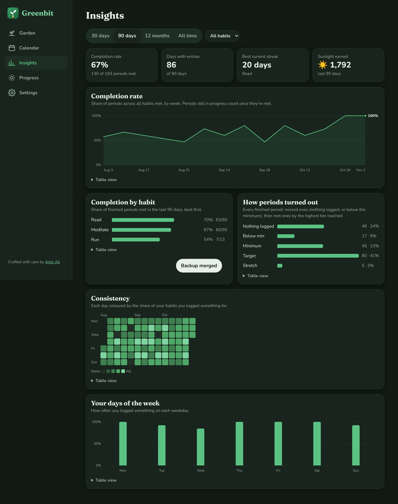

<p align="center">
  <picture>
    <source media="(prefers-color-scheme: dark)" srcset="brand/logo-wordmark-dark.svg">
    
  </picture>
</p>

<p align="center">
  <strong>Your tasks, notes and habits, growing together.</strong><br>
  A local-first, offline-ready productivity garden: Todoist-style tasks, Markdown notes, and habits that grow like plants, synced across your devices with end-to-end encryption.
</p>

<p align="center">
  <a href="https://greenbit-six.vercel.app"><strong>🌱 Open the live app</strong></a> ·
  <a href="https://amir-ali.me">Built by Amir Ali</a> ·
  <a href="#features">Features</a> ·
  <a href="#getting-started">Getting started</a> ·
  <a href="#how-it-works">How it works</a>
</p>

---

<p align="center">
  
</p>

<p align="center">
  
  &nbsp;
  
  &nbsp;
  
</p>

## What is Greenbit?

Greenbit is a Progressive Web App for getting things done and building habits, without accounts or tracking. Everything lives in your browser's IndexedDB on your device. You install it like an app on iOS, Android or desktop, and it keeps working with no connection. Optional sync keeps several browsers in step, end-to-end encrypted, like Brave Sync.

- **Tasks**, Todoist-style: projects, priorities P1–P4, labels, due dates and times, recurring tasks, reminders, and a natural-language quick add.
- **Notes** in Markdown with a rich-text editor: headings, checklists, tables, syntax-highlighted code blocks and a raw source mode.
- **Habits** that grow like plants, with goals, milestones, streaks and insights.

### Habits

Each habit gets three goals per period:

| Threshold | Meaning |
| --- | --- |
| **Minimum** | The least that still counts. Reaching it marks the period ✓ done. |
| **Target** | What a normal good day, week or month looks like. |
| **Stretch** | Going beyond expectations. Your plant blooms gold. |

Habits can be **daily**, **weekly** or **monthly**. Log as many entries as you like (e.g. 10 pages this morning, 15 tonight); they are summed per period. Ticks, streaks, colours, sunlight (XP), levels, plant stages and badges are **all derived from your entries** at read time. Nothing derived is stored, so editing or backfilling an entry instantly and consistently updates everything.

## Features

### Tasks

- ⚡ **Quick add with natural language** (press <kbd>Q</kbd> anywhere): `Pay rent every month on the 1st p1 #Home @bills at 9am !30m` fills in the title, recurrence, priority, project, label, time and a reminder, with each part highlighted as you type.
- 📥 **Today, Upcoming, Inbox, projects and labels**. Overdue tasks surface on Today with one-click "Reschedule to today". Completing and deleting both offer Undo.
- 🔁 **Recurring tasks** with Todoist semantics: `every` steps from the due date (and skips missed ones), `every!` counts from when you complete it. Supports weekdays, specific days, the Nth of the month (the 31st stays the last day in short months), intervals and end dates.
- ⏰ **Reminders** before the due time or at a set time, shown as browser notifications with **Complete** and **Snooze 10 min** buttons.

### Notes

<p align="center"></p>

- 📝 **Rich-text editor that saves Markdown** (TipTap): headings, bold/italic/strike, links, lists, checklists, quotes, dividers, **GFM tables** and **code blocks with syntax highlighting** (15 languages). Toggle to raw Markdown at any time.
- Search, pin and file notes under projects. Autosaves as you type.

### Habits

- 🌱 **Garden home**: one plant per habit that grows from seed → sprout → bud → bloom, with a current streak and a progress bar showing minimum / target / stretch for the current period.
- ➕ **Quick-add stepper** with +1 / +5 / +10 presets, custom amounts, notes and backfill to any past date.
- 📅 **Calendar** with two modes (your choice is remembered):
  - *Per habit*: daily cells coloured by tier. Weekly/monthly habits place the ✓ on the day the running total crossed the minimum, and tint the whole period.
  - *Combined*: every habit in one view, with ✓ / `2/3` / ✗ per day and a colour for the average tier.
- 🗓️ **Gentle rules**: an open period is never marked ✗ and never breaks your streak. Missed periods let plants wilt a little; they recover with the next good period.
- 📊 **Insights**: analytics for all habits or one, over 30 days, 90 days, 12 months or all time. Completion-rate trend, volume against your minimum/target/stretch lines, completion by habit, how periods turned out, a consistency heatmap and your best weekdays. Every chart has hover/keyboard tooltips and a table view.
- 🎯 **Goals and milestones**: a total to reach ("3,000 pages"), a streak to build or a number of periods to meet, with an optional deadline and pace tracking. Reaching a milestone triggers a celebration, appears on the Progress timeline and earns bonus sunlight.
- ☀️ **Gamification**: sunlight per period (below 1 · minimum 10 · target 15 · stretch 25), levels on a `50 · n^1.5` curve, garden stages from *Patch of soil* to *Grove*, eight badges and petal celebrations when you cross a threshold.
- 📜 **Daily quote** from public-domain translations of classic works (Marcus Aurelius, Seneca, Epictetus, Aristotle, William James and others), always with a named source.
### Everywhere

- 🔄 **End-to-end encrypted sync** across browsers and devices (see [How sync works](#how-sync-works)).
- 💾 **Export / import** as a single JSON file, validated with `zod`, with *merge* or *replace* applied atomically in one transaction. A nudge appears if you haven't backed up in 14 days.
- 📲 **PWA**: installable, works fully offline, self-hosted fonts, no network requests after load, auto-updating service worker.
- 🌓 **Dark mode**, keyboard accessible, `prefers-reduced-motion` respected, usable from 360px wide.

<p align="center">
  
</p>

<p align="center">
  
</p>

## Getting started

Requires Node 20+.

```bash
npm install
npm run dev        # http://localhost:5173
```

| Script | What it does |
| --- | --- |
| `npm run dev` | Start the Vite dev server |
| `npm run build` | Validate quotes, type-check and build the PWA into `dist/` |
| `npm run preview` | Serve the production build locally |
| `npm test` | Run the Vitest suite |
| `npm run validate:quotes` | Fail if any quote lacks an author/source or is duplicated |

## How it works

### Stack

React 18 · TypeScript · Vite · `vite-plugin-pwa` (Workbox) · Dexie (IndexedDB) · Zustand · TipTap + `@tiptap/markdown` · lowlight · date-fns · Framer Motion · zod · WebCrypto · `@scure/bip39` · Vercel Functions + Blob · Vitest + Testing Library.

### Project layout

```
src/
  core/         Pure, framework-free logic with unit tests
                (tasks, recurrence, quick add, reminders, clocks, goals, periods, streaks,
                 calendar, analytics, xp, plant, badges, backup)
  sync/         Sync chain crypto, per-record merge, sync engine
  reminders/    Notification scheduler
  data/         quotes.json, plant species
  db/           Dexie schema, repository (CRUD, import, reset), live-query hooks
  store/        Zustand UI state (today, calendar cursor, celebrations, toasts)
  components/   Plant, QuoteCard, Sheet, EntrySheet, MonthGrid, ThresholdBar…
    charts/     Dependency-free SVG charts: line, column, bar list, heatmap
  pages/        tasks/ (Today, Upcoming, project views), Notes, Garden, Calendar,
                Insights, HabitDetail, HabitForm, Progress, Settings, SyncJoin
server/         Sync relay (pure handler + Vercel Blob store), with tests
api/            Vercel Function entry for the relay
  styles/       Design tokens (light + dark) and global styles
scripts/        validate-quotes.ts
brand/          Logo sources and icon generator
```

### Data model

Only source records are stored: **tasks, projects, labels, notes, habits, habit entries, goals** and **settings**. Each carries a clock stamp (`hlc`) and, once deleted, a tombstone (`deletedAt`), which is what makes sync merges safe. Dates are local `YYYY-MM-DD` strings, never UTC timestamps, so time zones and DST can't shift a day.

```ts
interface Habit { id; name; unit; frequency: 'daily' | 'weekly' | 'monthly';
                  minimum; target; stretch; plant; createdAt; archivedAt? }
interface Entry { id; habitId; date; volume; note? }
```

### Decisions worth knowing

- **Backfilling before a habit's start date** moves the habit's `createdAt` back to that date, so the backfilled period counts.
- **Changing thresholds or frequency** recalculates all history (the form warns you first). That follows from never storing derived values.
- **Combined calendar**: weekly/monthly habits only count on their completion day (✓) or on the last day of a missed period (✗). They never count against the other days.
- **Merge import** adds anything missing by id; if a record exists on both sides, the one edited most recently wins.
- **Backups from newer app versions** are rejected with a clear message. A `migrate()` hook upgrades older formats.
- **Chart colours** are validated, not eyeballed: charts use one green hue (lines, bars) and a single-hue ramp for the heatmap, checked for contrast and lightness steps in light and dark mode. The five-colour tier palette stays on the calendar, where ✓/✗/★ marks back it up.
- Every tier colour is paired with a non-colour cue (✓, ✗, ★ for stretch, and text labels) so the calendar stays readable with colour-vision deficiencies.

### Quotes

`src/data/quotes.json` holds 68 quotes, each with an author, a work, a book/letter/chapter reference and, where relevant, the public-domain translator. The selector is `quotes[dayOfYear % quotes.length]`, so the quote changes at local midnight and the list can grow to 365 with no code change.

> **Human review needed before release.** The quotes were transcribed from well-known public-domain translations without being machine-checked against the source texts. Each one has a precise reference to make that check quick.

## How sync works

Sync follows the model Brave Sync uses: devices share a secret, and a relay stores data it cannot read.

1. **A sync chain is 32 random bytes**, created on your device. You move it to another device as **24 words** (BIP39) or as a **QR code / link**: scan it with the phone's camera app, or in Greenbit with **Settings → Sync → I have a sync code → Scan QR code** (or pick a photo of it). The link carries the secret in the URL fragment (`/sync#k=…`), which browsers never send to a server, and Greenbit removes it from the address bar right after reading it.
2. **Two keys are derived** with HKDF-SHA256: an AES-256-GCM key that never leaves your devices, and a relay key that authorises access. The relay stores data under `SHA-256(relay key)`, so it never holds the key itself, and there are no accounts.
3. **What's uploaded** is one blob per chain: every record, gzipped, then encrypted. The relay (`api/sync.ts`, backed by a private Vercel Blob store) only sees ciphertext and its size.
4. **Merging** is per record using hybrid logical clock stamps: the newest edit of each task, note, habit or entry wins, and deletions are tombstones, so a delete on one device beats an older edit on another. Writes are conditional on the relay's ETag; if two devices write at once, the later one re-merges and retries, so nothing is overwritten.
5. **When it syncs:** on open, a few seconds after an edit, when you come back to the app (focus the window, show the tab, or the first tap after a pause; at most once a minute), when back online, and every 5 minutes while visible. It never polls in the background. Pending changes are worked out from the data itself, so an edit is never lost by closing a tab quickly.

**If something goes wrong:** a write the relay refuses twice is resolved automatically by saving the merge of the copy just downloaded (safe, because every sync merges full state per record, so any device whose change was overtaken sends it again on its next sync). Conflicting writes are retried with a short random backoff, and only one tab or window per device syncs at a time. A failed sync shows as "Retrying…", not an error, and is retried automatically three times (after 5 s, then as a background repair after 15 s and 30 s). Only if all three fail does a popup offer **Repair sync** or **Report a bug**; retries continue quietly every few minutes. Manual **Settings → Sync → Repair sync** downloads the synced copy, merges it per record with this device (keeping the newest version of everything from both) and saves the result for all devices. Nothing on the device is dropped. **Settings → Sync → Sync activity** shows recent sync steps (request types, results and version tags only) and is included in bug reports. An open note updates in place when another device edits it, unless you're typing in it at that moment.

Limits: tombstones are forgotten after 60 days, so a device that stays offline longer than that could bring back something you deleted. Each chain is capped at 4 MB compressed. Anyone with your 24 words or link can read and change your synced data: treat it like a password.

## Privacy

- **No analytics, no tracking.** Greenbit collects no analytics, telemetry or usage data, shows no ads, and uses no cookies or third-party trackers.
- **Your data stays on your devices**, in the browser's IndexedDB. There are no accounts.
- **Sync is end-to-end encrypted**: the relay only ever stores ciphertext.
- **No automatic crash reports.** The in-app **Report a bug** button opens a pre-filled GitHub issue with technical details only (version, browser, screen size, whether sync and notifications are on). Nothing is sent until you submit it.
- Like any website, the host (Vercel) keeps standard short-lived request logs (IP address, time).

## Reminders: what to expect

Greenbit has no push server, so a browser can only show a reminder while Greenbit is open or running in a background tab. Reminders that come due while it's fully closed appear as soon as you open it again. On iPhone and iPad, web notifications require adding Greenbit to the Home Screen first.

## Deployment

Live at **[greenbit-six.vercel.app](https://greenbit-six.vercel.app)**. The app is deployed on Vercel from this repository on every push. `vercel.json` holds the SPA rewrite and cache headers. The sync relay is a single Vercel Function (`api/sync.ts`) using a private Vercel Blob store, through the `BLOB_READ_WRITE_TOKEN` that connecting the store to the project provides. Without sync, the app is purely static: build and serve `dist/`.

## Author

Designed and built by **Amir Ali**: [amir-ali.me](https://amir-ali.me) · [GitHub](https://github.com/amirsaeed671)

If Greenbit helps you grow something, a ⭐ on the repo is appreciated.
